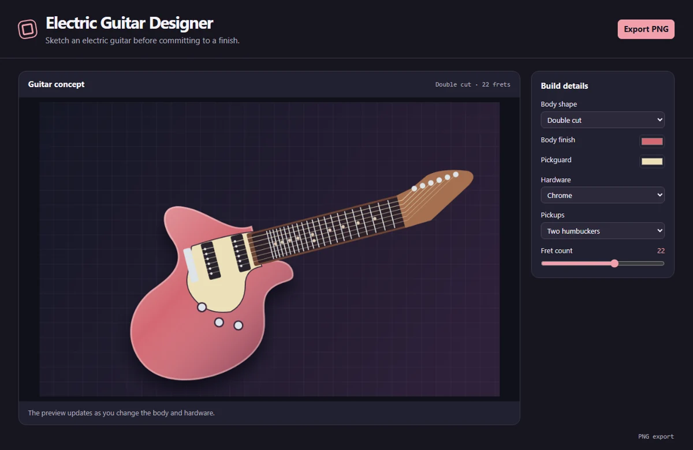

# Electric Guitar Designer

Design an electric guitar concept with three body shapes, custom finishes, pickup layouts, hardware, and PNG export.



## Run locally

Install Node.js 24 and npm. From the repository directory, run:

```sh
npm ci
npm start
```

The first command installs the locked dependencies. The second opens the desktop window and may download the pinned Electron runtime on first launch. All artwork is processed locally. The app requires no account or API key.

## Use the app

Choose a double cut, single cut, or offset body. Adjust the finish and pickguard separately, then choose a pickup layout, hardware color, and fret count. Export a 1000 × 640 PNG of the rendered concept.

The drawing is a visual mockup. It does not specify measurements, intonation, wiring, or manufacturing tolerances.

## Project layout

- `main.cjs` creates the Electron window and handles native export dialogs.
- `preload.cjs` exposes the small set of desktop operations available to the renderer.
- `app.js` manages shared controls, canvas input, and export encoding.
- `tool.js` contains this app's drawing and editing logic.

## Verify

```sh
npm test
```

The test starts an offscreen Electron window, changes a real editor control, verifies the resulting artwork, and checks the encoded export. On a headless Linux host with Xvfb, use `xvfb-run -a npm test`.
